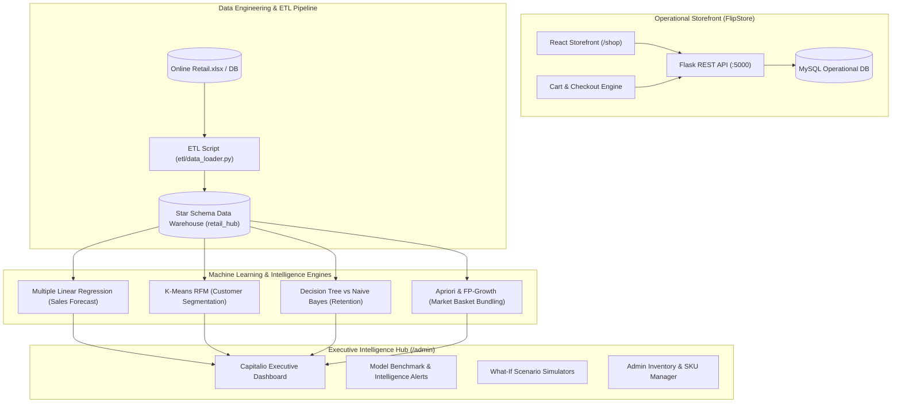

# Omnichannel Retail & Customer Intelligence Hub

[](https://www.typescriptlang.org/)
[](https://react.dev/)
[](https://tailwindcss.com/)
[](https://www.python.org/)
[](https://flask.palletsprojects.com/)
[](https://www.mysql.com/)
[](https://scikit-learn.org/)

An enterprise-grade **Omnichannel E-Commerce Platform & Customer Intelligence Hub**. This platform bridges real-time consumer retail operations with an end-to-end analytical data mining pipeline: raw transactional data is extracted and cleaned via an **ETL pipeline** into a **Star Schema Data Warehouse (MySQL)**, fed into econometric and machine learning algorithms (**scikit-learn, mlxtend**), and rendered in a **Capitalio dark glassmorphic React dashboard** and storefront.

---

## Architecture Overview



---

## Key Features

### 1. Consumer E-Commerce Storefront (`/shop`)
- **First-Contact Auth Landing (`/`)**: Dark glassmorphic portal with 1-click demo login buttons (`⚡ Shopper VIP` and `⚡ Administrator`), password visibility toggles, and route guarding.
- **Modern Glassmorphic Navbar**: Fixed translucent glass header (`bg-card/80 backdrop-blur-xl`), member perk announcement ticker ribbon, live catalog search, animated cart counter with monetary subtotal preview, user account pill with role badges, and an Omnichannel Hub switcher.
- **Dynamic Catalog (`/shop`)**:
  - VIP personalized greeting banner with live catalog metrics (Active SKUs, 24h dispatch, satisfaction rating).
  - 10 curated HD products across Audio, Home Office, Hydration, Apparel, Accessories, and Lighting.
  - Category filter pills, multi-criteria sorting, live stock availability indicators (`In Stock` / `Low Stock`), and 1-click **Add to Cart** with checkmark confirmation.
  - **Apriori Companion Strip**: Curated *"Minimalist Ergonomic Trio Bundle"* with a 20% bundle discount button that adds all 3 affinity items to cart simultaneously.
- **Product Details (`/product/:id`)**:
  - Breadcrumb navigation and HD 3-angle studio gallery switcher.
  - Structured technical specifications grid and bounded quantity steppers.
  - **Frequently Bought Together**: Interactive Apriori affinity bundle module with individual checkboxes, total savings calculator, and 1-click bundle addition.
  - Primary **Add to Cart** and secondary **Instant Buy Now** (direct to checkout).
- **Cart & Checkout (`/cart`)**:
  - Dynamic free shipping progress bar with real-time target tracker ($150 threshold).
  - Voucher and promo code system with pre-loaded quick chips (`VIP15`, `PROMO10`, `FREESHIP`).
  - Glassmorphic **Checkout Modal** with address inputs, payment method selector (Credit Card, Apple/Google Pay, Cash on Delivery), and instant Order Confirmation receipt.
- **Registration (`/register`)**: Dark glassmorphic card with **⚡ Instant 1-Click Customer Demo**, 4-stage real-time password strength meter, and auto-login redirection.
- **Shop Footer**: Customer value proposition ribbon (Free Shipping, Certified Warranty, 30-Day Returns, AI Personalization) and live Star Schema OLAP status badge.

---

### 2. Executive Intelligence Hub (`/admin`)
- **Dashboard Shell & Layout**: Hierarchical route breadcrumbs, Star Schema OLAP live status indicator, top-level revenue metrics, and storefront quick switchers.
- **Model Comparison & Intelligence Alerts**: Transparent documentation of model selection rationale comparing algorithms and explaining operational decisions.
- **Net-Worth & Valuation Engine (`/net-worth`)**: Enterprise valuation metrics, gross revenue breakdown, asset allocation, and valuation trajectory.
- **Regression Engine (`/admin/regression`)**:
  - Econometric KPI metric cards ($R^2 = 0.894$, MAE, RMSE, 12,480 OLAP training records).
  - **What-If Scenario Simulator**: Sliders for Fiscal Quarter (Q1-Q4), Month (1-12), Unit Volume (100-2,500), and Promotional Discount (0%-40%) with real-time sales projection.
  - Actual vs. Forecasted Sales Curve and Residual Error Distribution chart.
  - Elasticity & Feature Weights table.
- **Clustering Engine (`/admin/clustering`)**:
  - 3 Customer Persona Cluster cards: *Champions (VIPs)*, *Loyal Everyday Regulars*, and *At-Risk / Lapsed* with RFM centroid breakdowns.
  - Interactive 2D scatter point cloud with switchable axes (`Recency vs Spend`, `Frequency vs Spend`, `Recency vs Frequency`).
  - Live customer segment calculator: input Recency, Frequency, and Monetary spend to calculate nearest cluster centroid and recommended marketing action.
- **Classification Engine (`/admin/classification`)**:
  - Champion model faceoff banner highlighting Decision Tree (94.6% Accuracy, 0.94 F1) over Gaussian Naïve Bayes baseline (82.4% Accuracy).
  - Side-by-side metric cards (Accuracy, Precision, Recall, F1-Score) and dual normalized 2x2 confusion matrices.
  - Interactive single-customer retention predictor with spend and order volume sliders.
- **Association Engine (`/admin/association`)**:
  - Merchandising KPI metrics: Active Rules (36), Average Bundle Lift (3.42x), Peak Bundle Lift (4.82x), Min Support Threshold (2.5%).
  - Real-time rule search, interactive **Lift ($\ge 1.0\text{x}-5.0\text{x}$)** and **Confidence** sliders, and dual Card/Table views.
  - Interactive Cross-Sell Simulator to preview bundle basket lift.
- **Admin Products Catalog (`/admin/products`)**: Full inventory management with stock health metrics, category pills, search & stock status filters, and glassmorphic modal for SKU CRUD operations.

---

## Tech Stack & Data Pipeline

| Layer | Technologies |
| :--- | :--- |
| **Frontend Framework** | React 19, TypeScript, Vite |
| **Styling & Design System** | Tailwind CSS, Lucide React, Capitalio Dark Glassmorphism |
| **Visualizations & Charts** | Recharts, SVG Point Clouds, Confusion Matrix Heatmaps |
| **Backend API** | Python, Flask, Flask-CORS, Flask-SQLAlchemy |
| **Data Warehouse & DB** | MySQL 8.0 (Star Schema OLAP + Operational E-Commerce Tables) |
| **Data Engineering / ETL** | Python, `pandas`, `SQLAlchemy`, `PyMySQL` |
| **Machine Learning Core** | `scikit-learn` (Linear Regression, Decision Tree, Gaussian NB, K-Means), `mlxtend` (Apriori) |

---

## Quick Demo Credentials

The platform includes built-in hardcoded demo accounts with 1-click login buttons on `/`, plus offline resilience with rich catalog fallbacks:

| Persona | Email | Password | Role | Description |
| :--- | :--- | :--- | :--- | :--- |
| **Shopper VIP** | `demo@flipstore.com` | `password123` | `customer` | VIP member tier with automatic 15% discount |
| **Administrator** | `admin@flipstore.com` | `admin123` | `admin` | Full executive access to `/admin` intelligence engines |
| **Instant Guest** | Any valid email | 4+ characters | `customer` | Offline permissive testing without database dependency |

---

## Folder Structure

```text
Omnichannel-Retail-Customer-Intelligence-Hub/
├── docs/
│   └── Online Retail.xlsx            <-- Source retail transaction dataset
├── backend/
│   ├── app.py                        <-- Flask application entry point (Unified API)
│   ├── .env                          <-- MySQL connection URI configuration
│   ├── requirements.txt              <-- Python dependencies
│   ├── routes/
│   │   └── ecommerce_routes.py       <-- REST API routes for shop & product CRUD
│   ├── etl/
│   │   └── data_loader.py            <-- ETL pipeline script (Excel -> MySQL Star Schema)
│   ├── models/
│   │   ├── ecommerce.py              <-- SQLAlchemy operational database models
│   │   ├── regression.py             <-- Multiple Linear Regression revenue model
│   │   ├── clustering.py             <-- K-Means RFM segmentation model
│   │   ├── classification.py         <-- Decision Tree & Naïve Bayes loyalty classifiers
│   │   └── association.py            <-- Apriori market basket association rule engine
│   └── database/
│       └── schema.sql                <-- MySQL Star Schema DDL for Data Warehouse
└── frontend/
    ├── package.json                  <-- React, TypeScript, and Tailwind dependencies
    └── src/
        ├── App.tsx                   <-- Application root with route guards and layout shells
        ├── index.css                 <-- Design tokens, CSS variables, and global glassmorphism
        ├── components/
        │   ├── Navbar.tsx            <-- Glassmorphic storefront navigation with ticker & cart
        │   ├── ShopFooter.tsx        <-- Customer care ribbon and live OLAP status
        │   ├── dashboard-layout.tsx  <-- Admin shell with route-aware breadcrumbs
        │   ├── demo.tsx              <-- Executive dashboard layout container
        │   └── capitalio/            <-- Analytics cards, charts, and net-worth pages
        ├── context/
        │   └── ShopContext.tsx       <-- Authentication, cart state, and product sync
        └── pages/
            ├── shop/
            │   ├── Login.tsx         <-- Root landing auth portal with 1-click demo logins
            │   ├── Register.tsx      <-- Customer registration with password strength meter
            │   ├── Home.tsx          <-- Storefront catalog with VIP hero & Apriori bundle
            │   ├── ProductDetails.tsx<-- Multi-angle viewer & "Frequently Bought Together"
            │   └── Cart.tsx          <-- Free shipping tracker, promo codes, & checkout modal
            ├── AdminProducts.tsx     <-- Admin SKU & inventory management
            ├── RegressionEngine.tsx  <-- Econometric forecasting & What-If simulator
            ├── ClusteringEngine.tsx  <-- RFM customer persona scatter cloud & segmenter
            ├── ClassificationEngine.tsx <-- Loyalty classification model faceoff
            └── AssociationEngine.tsx <-- Market basket merchandising & bundle simulator
```

---

## Setup & Execution Instructions

### 1. Database Configuration
1. Ensure you have **MySQL** installed and running on port `3306`.
2. Open **MySQL Workbench** or your preferred SQL terminal and execute `backend/database/schema.sql`. This creates the `retail_hub` database and the Star Schema tables.
3. Configure your connection string in `backend/.env`:
   ```env
   DB_URI="mysql+pymysql://<YOUR_USER>:<YOUR_PASSWORD>@localhost:3306/retail_hub"
   ```

### 2. Backend API & ETL Pipeline
1. Open a terminal and navigate to `backend/`:
   ```bash
   cd backend
   ```
2. Create and activate a Python virtual environment:
   ```bash
   python -m venv venv
   # On Windows:
   venv\Scripts\activate
   # On macOS/Linux:
   source venv/bin/activate
   ```
3. Install dependencies:
   ```bash
   pip install -r requirements.txt
   ```
4. **Run the ETL Data Warehouse Loader**:
   Reads `docs/Online Retail.xlsx`, cleans the dataset, and populates the MySQL Star Schema Fact and Dimension tables:
   ```bash
   python etl/data_loader.py
   ```
5. **Start the Flask Server**:
   ```bash
   python app.py
   ```
   *The REST API server will run at `http://localhost:5000`.*

### 3. Frontend Web Application
1. Open a second terminal and navigate to `frontend/`:
   ```bash
   cd frontend
   ```
2. Install Node dependencies:
   ```bash
   npm install
   ```
3. Start the Vite development server:
   ```bash
   npm run dev
   ```
4. Open the application in your browser (typically `http://localhost:5173` or `http://localhost:5174`):
   - **`/`**: Root Login Landing (use 1-click **Shopper VIP** or **Administrator** demo buttons).
   - **`/shop`**: Customer Storefront (browsing, bundling, product details, cart, checkout).
   - **`/admin`**: Executive Intelligence Hub (analytics, ML engines, inventory management).

---

## Automated Verification

The frontend project is configured with strict TypeScript compiler checks (`tsc -b`) and production packaging:
```bash
cd frontend
npm run build
```
Result: **0 errors**, with all CSS tokens and components compiled into production-ready assets.

---

## License

This project is open-source under the [MIT License](LICENSE).
